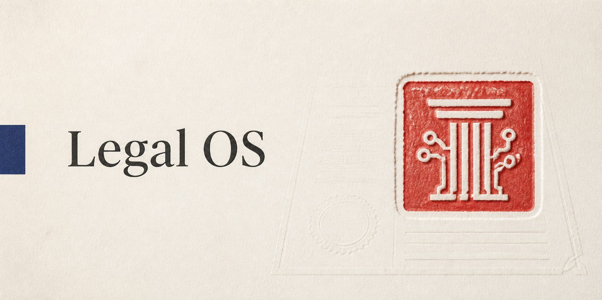

<p align="center">
  
</p>

<h1 align="center">Legal OS</h1>

<p align="center">
  <strong>面向中国法律工作的 AI 工作流工具集</strong>
</p>

<p align="center">
  帮助律师和法务处理合同、诉讼、法律研究、证据核验与文件交付。
</p>

<p align="center">
  
  
  <a href="LICENSE"></a>
</p>

<p align="center">
  <a href="#核心功能">核心功能</a> ·
  <a href="#快速开始">快速开始</a> ·
  <a href="#使用示例">使用示例</a> ·
  <a href="docs/capability-matrix.md">全部能力</a> ·
  <a href="docs/architecture.md">项目文档</a>
</p>

---

## 当前版本

**v0.8.4 公开预发布版。** 包含 15 个 Skills、12 条路由和 24 个标准 Office 模板。

## Legal OS 能做什么

Legal OS 为 AI 法律工作提供可复用的流程和工具，让材料分析、专业核验、文书制作和文件交付更容易检查与衔接。

## 核心功能

- **合同审核与修订**：识别合同风险，提出修改意见并检查修订文件。
- **诉讼与仲裁准备**：分析请求、抗辩、证据和策略，协助制作法律文书。
- **法律研究**：查询中国现行法律和公开案例，整理适用依据与争点。
- **证据与金额核验**：核对材料证明范围、金额、付款、日期和计算过程。
- **函件与沟通**：起草正式函件、业务邮件和沟通口径。
- **文件与汇报交付**：处理 Word、Excel、PDF 等文件，整理报告与演示材料。

## 工作方式

1. 提供任务和相关材料。
2. 选择对应的工作流程，梳理事实、风险和待补信息。
3. 核验依据并制作所需成果。
4. 检查文件和内容，再由使用者确认后交付或采取外部行动。

## 快速开始

Legal OS Skills 可安装到 Codex：

```bash
./install.sh --dry-run
./install.sh
```

然后在 Codex 中按任务调用对应 Skill，例如：

```text
使用 $legal-os-contract 审核这份合同，列出主要风险并提出修改建议。
```

安装方式和替换选项见 [`install.sh`](install.sh)；各模块说明见[能力矩阵](docs/capability-matrix.md)。

## 使用示例

- “分析这份合同的主要风险，并给出可执行的修改建议。”
- “根据现有材料梳理诉讼请求、证据缺口和待确认问题。”
- “核验这项法律规定的现行效力和适用条文。”
- “核对付款记录和金额计算，说明差异及其依据。”

## 使用边界

- AI 输出供律师、法务或其他专业人员复核，不替代专业判断。
- 法律依据和具体事项事实应根据适用来源与实际材料核验。
- 发送、提交、签署等外部行动须由使用者另行确认授权。

## 文档

- [能力矩阵](docs/capability-matrix.md) · [系统架构](docs/architecture.md) · [`install.sh`](install.sh)
- [使用说明与贡献方式](CONTRIBUTING.md) · [版本记录](CHANGELOG.md) · [许可证](LICENSE)
- [公开首页与版本文案规则](docs/public-homepage-and-release-rules.md)

Legal OS 的公开适配参考了 [`cn-law-hub`](https://github.com/ZongziForu/cn-law-hub) 分享的实践；本项目独立维护，不代表双方存在隶属或官方合作关系。
